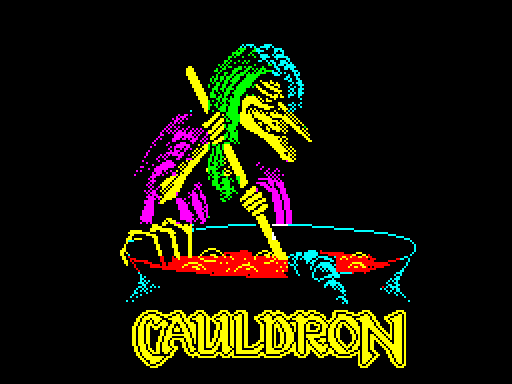
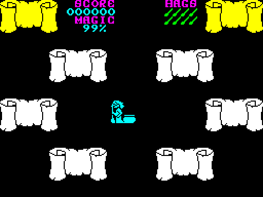
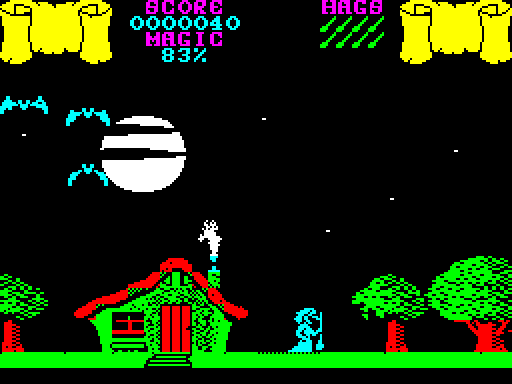
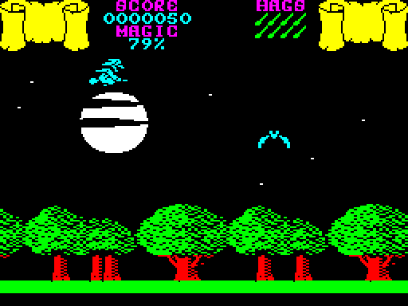
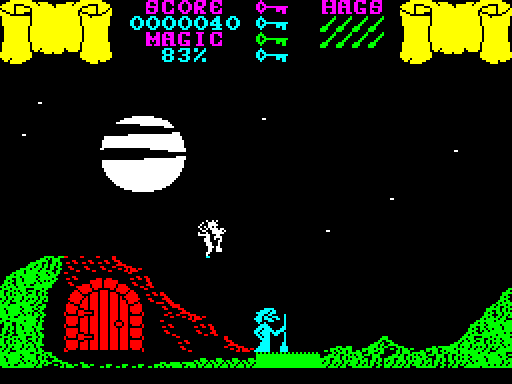
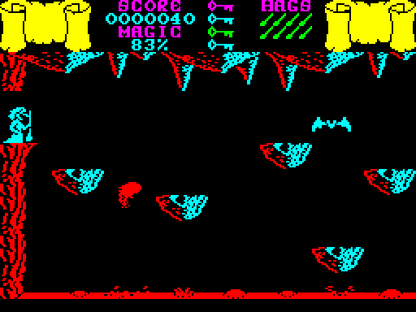

# Cauldron for the BBC Micro

A work-in-progress port of *Cauldron* (Palace Software, 1985), from the
48K ZX Spectrum to the BBC Micro: a Model B with 16K of sideways RAM, and
the Master 128, from one disc.

**[Run it in jsbeeb](https://bbc.xania.org/?autoboot&disc1=github:mattgodbolt/cauldron-beeb/cauldron.ssd)**
([the drawing's viewer](https://bbc.xania.org/?autoboot&disc1=github:mattgodbolt/cauldron-beeb/viewer.ssd))
([on a Master](https://bbc.xania.org/?autoboot&model=Master&disc1=github:mattgodbolt/cauldron-beeb/cauldron.ssd))

 
 
 

*Cauldron* puts you on a witch's broomstick over a moonlit landscape of
forests and hills, fending off bats, ghosts and the rest with her
magic, finding the keys that open the doors in the hills and the
ingredients for the spell that will deal with the Pumpkin. The port
is a work in progress, but it plays: the loading screen, the menu
(**4** plays), the hag in her house, then out into the night, flying,
firing, the landscape pushing on from screen to screen, the doors to the
caverns underground, and BEEPER's chirps as SN76489 tones.

The keys are **Z** and **X** for left and right, **:** and **/** for up
and down, and **RETURN** to fire. (In jsbeeb on a PC keyboard, **:** is
the **'** key.) The menu's options 1 to 3 choose the Spectrum's
controls and do nothing useful here yet.

It needs 32K of sideways RAM: a Model B with two banks, or a Master.
Getting it into one 16K bank is still to do.

## No colour clash

The Spectrum's sprites take the colour of whatever character cell they
cross. The port has none of that (`docs/decisions.md`, decision 5): the
screen is MODE 1 laid out in the Spectrum's geometry, its lit pixels
exactly the original's at all times, and a sprite keeps its own colour
except where it crosses scenery, which keeps the scenery's. Palette
changes partway down the screen give each band of it the colours the
original's attributes asked for. The loading screen has its own, line
by line, so the witch keeps her green and cyan hair (decision 13).

## The original's program, compiled again

The Spectrum original turns out to be compiled BASIC, apart from a
runtime library and a few machine code helpers. So its game logic is a
BASIC program, recovered by a decompiler for its compiler's output
(`tools/decompile.py`, `docs/research/compiler.md`). The port compiles
that program again, for the 6502: to compact bytecode for an
interpreter, with the statements a pass runs most compiled to native
code that runs from one to the next (decision 10). The library's
quirks come with it, so the port's logic does what the original's did
to the bit:

- `make vm` runs every statement on a 6502 simulator and the original's
  Z80 code from the same random state, and compares the results.
- `make passes` plays the original and the port side by side, the same
  keys held, and compares every variable at every pass of the main
  loop, and the screen every tenth.

## Speed

The original has no frame sync. A pass of its main loop takes as long
as the Spectrum's Z80 takes over it, slower as more sprites come on.
The port starts each pass on the vertical sync at a fixed 5 frames
(decision 6), the original's pace standing still. The BBC's 2MHz 6502
now does a pass's work in less time than the 3.5MHz Z80 did, in every
case measured:

| A pass of the main loop | The original | The port's work |
|---|---|---|
| Standing still (median) | 5.25 frames | 2.8 frames |
| Flying (median) | 6.1 frames | 3.7 frames |
| Flying and firing (median) | 7.8 frames | 4.2 frames |

So where the original bogs down in flight, the port holds its 5
frames. (Measured 2026-10-30, with `tools/passtime.mjs` and its
Spectrum counterpart: `docs/speed.md` has the runs, and how it got
there.)

This is an unofficial port. *Cauldron* was designed by Steve Brown; the
Spectrum version, which this port is made from, is by Ramjam (Tony
Barber and Simon Dunstan). The original's files are not in this
repository: `make fetch` downloads them from
[Spectrum Computing](https://spectrumcomputing.co.uk/entry/850/).

## How it's made

The port is made the way the
[Chuckie Egg 2](https://github.com/mattgodbolt/chuckie-egg-2-beeb) and
Ninja Massacre ports were, after Kieran Connell's
[beeb-port-kit](https://github.com/kieranhj/beeb-port-kit): the original
is the specification, every deviation is a numbered decision in
`docs/decisions.md`, and the port is built one layer at a time, each
checked against the original running headless: the Spectrum's on
SkoolKit's Z80 simulator, the BBC's in [jsbeeb](https://github.com/mattgodbolt/jsbeeb).

## Building

You need [baron](https://github.com/waitingforvsync/baron) (at
`../baron/build/src/baron` or on the PATH), Node, and
[uv](https://github.com/astral-sh/uv) for the Python tools.

```sh
npm ci          # the jsbeeb harness (jsbeeb-mcp)
make venv       # .venv with SkoolKit and Pillow
make fetch      # the original, from Spectrum Computing
make            # build/cauldron.ssd
make run        # boot it in jsbeeb, screenshot to shots/run.png
make zx         # the original, loaded, as build/cauldron.z80
make check      # the checks: drawing, sprites, the logic, pass by pass
```

## Layout

| Path | What |
|---|---|
| `src/` | the port, in 6502 assembly for baron |
| `tools/` | the build's converters, the harness for jsbeeb (`beeb.mjs`, `play.mjs`) and for the Spectrum (`zx.py`, on SkoolKit) |
| `docs/journal.md` | how it got here, in order |
| `docs/research/` | how the original works |
| `docs/decisions.md` | every call the port makes that the original didn't |
| `docs/speed.md` | making it fast enough, and the measurements |
| `original/` | the original's checksums; `make fetch` puts the files here |

## Thanks

Kieran Connell for the port kit and jsbeeb-mcp, Rich Talbot-Watkins for
baron, Richard Dymond for SkoolKit, and Spectrum Computing (ZXDB) for
the original and its maps.
